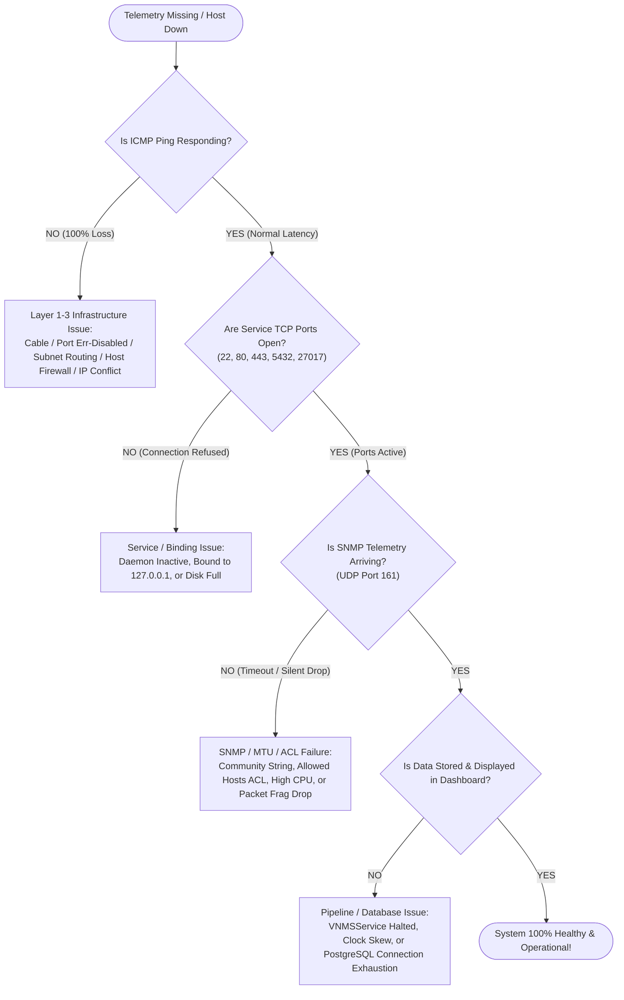

# V-NMS Enterprise Network Data & Polling Troubleshooting Guide
**Standard Operating Procedure (SOP): Comprehensive 20-Condition Diagnostic Reference for Missing Telemetry, Polling Drops, and Offline Devices**

---

## 1. Executive Diagnostic Flowchart

When the V-NMS dashboard displays a device as **Offline**, **Missing Ports**, **Blank Storage/Disk IO**, or **Zero Traffic**, the root cause exists in one of the 8 technical categories below. 

Follow this 30-second diagnostic decision tree to isolate the exact layer:



---

## 2. Category 1: Physical & Data Link Layer Failures (Layer 1 & Layer 2)

### Condition 1.1: Physical Cable Disconnection, Power Loss, or Switch Port Err-Disabled
* **Symptom:** Target host shows 100% packet loss (`Destination Host Unreachable` or `Request timed out`).
* **Root Cause:** 
  1. The target server/switch is powered down.
  2. Ethernet patch cord is disconnected or damaged.
  3. The switch port entered an `err-disabled` state due to BPDU Guard, Port Security violation, or link flapping.
* **Diagnostic Command:**
  ```powershell
  # Check if the hardware MAC address exists in the local ARP cache
  arp -a | findstr "<TARGET_IP>"
  ```
  If absent, the host is not physically present on the local link.
* **Resolution Steps:**
  1. Inspect the physical NIC link indicator LED (ensure solid amber/green link).
  2. On the upstream managed switch (e.g., Cisco Catalyst 9300), verify the interface state:
     ```cisco
     show interface status | include <PORT_ID>
     show interface <PORT_ID> err-disabled
     ```
  3. Reset the disabled port:
     ```cisco
     configure terminal
     interface <PORT_ID>
      shutdown
      no shutdown
     exit
     ```

---

### Condition 1.2: VLAN Assignment Mismatch
* **Symptom:** Physical link LED is green, but the host cannot communicate with any device on the subnet.
* **Root Cause:** The switch port is assigned to an incorrect Access VLAN (e.g., Target is statically configured for `172.168.1.0/24` on VLAN 10, but the switch port is assigned to default VLAN 1).
* **Resolution Steps:**
  ```cisco
  configure terminal
  interface <PORT_ID>
   switchport mode access
   switchport access vlan 10
   spanning-tree portfast
  exit
  ```

---

### Condition 1.3: Duplicate IP Address Conflict (ARP Poisoning / IP Clash)
* **Symptom:** Telemetry intermittently flaps between two completely different devices (e.g., a Linux server and a printer); ping response latency spikes erratically; MAC address in `arp -a` alternates continuously.
* **Root Cause:** A statically assigned IP on a server clashes with a DHCP reservation or another unrecorded machine on the subnet.
* **Diagnostic Verification:**
  ```powershell
  # Check for changing MAC address for the same IP
  arp -a | findstr "<TARGET_IP>"
  ```
* **Resolution Steps:**
  1. Identify the conflicting MAC addresses and track the switch port via MAC address table:
     ```cisco
     show mac address-table address <CONFLICTING_MAC>
     ```
  2. Reassign the offending machine to a free static IP verified via V-NMS IPAM.

---

## 3. Category 2: Network & Routing Failures (Layer 3)

### Condition 2.1: Missing Default Gateway or Inactive Inter-VLAN Routing
* **Symptom:** V-NMS discovers local subnet devices (`172.168.1.0/24`), but all targets on neighboring subnets (`192.168.10.0/24`, `10.0.0.0/24`) report 100% packet loss.
* **Root Cause:** The V-NMS host lacks a default gateway route (`172.168.1.1`), or the Core Switch / Firewall lacks an active route between subnets.
* **Diagnostic Command:**
  ```powershell
  tracert -d <TARGET_IP>
  ```
* **Resolution Steps:**
  1. Confirm default gateway reachability on the V-NMS server:
     ```powershell
     Get-NetRoute -DestinationPrefix "0.0.0.0/0"
     ```
  2. Verify that IP routing is globally enabled on the Core Switch:
     ```cisco
     show ip route
     configure terminal
     ip routing
     ```

---

### Condition 2.2: Subnet Mask Mismatch
* **Symptom:** Target can communicate with some local devices, but cannot receive packets from the V-NMS monitoring server.
* **Root Cause:** The target was configured with an incorrect subnet mask (e.g., `255.255.255.128` (/25) instead of `255.255.255.0` (/24)), causing it to treat the V-NMS server IP as external and attempt to route through a non-existent gateway.
* **Resolution Steps:**
  Verify and update the subnet mask on the target host network adapter to match the subnet definition (`255.255.255.0`).

---

### Condition 2.3: MTU Mismatch & UDP Packet Fragmentation Drop
* **Symptom:** Standard ICMP ping works with small packets (32 bytes), but large SNMP queries (such as full routing tables or 48-port switch interface walks) fail or hang.
* **Root Cause:** Large SNMP response packets exceed the Maximum Transmission Unit (MTU 1500) and get fragmented. If an intermediate router, VPN tunnel, or firewall drops fragmented UDP packets, the SNMP walk times out.
* **Diagnostic Verification:**
  ```powershell
  # Test ping with large packet and Don't Fragment (DF) flag set
  ping <TARGET_IP> -f -l 1472
  ```
  If this returns `Packet needs to be fragmented but DF set`, MTU clamping or fragmentation filtering is occurring along the path.
* **Resolution Steps:**
  1. Ensure VPN tunnels have appropriate MSS/MTU clamping configured:
     ```cisco
     interface Tunnel1
      ip mtu 1400
      ip tcp adjust-mss 1360
     ```
  2. Allow UDP packet fragmentation on intermediate firewalls.

---

## 4. Category 3: Security & Firewall Filtering Failures (Layer 4 & Layer 7)

### Condition 3.1: Host Firewall Dropping ICMP Echo Requests
* **Symptom:** Web and SSH ports are accessible on the target, but ICMP Ping times out, causing V-NMS to mark the host as "DOWN".
* **Root Cause:** Windows Defender Firewall or Linux Netfilter (`nftables` / `iptables`) drops inbound ICMPv4 Type 8 Echo Requests by default.
* **Resolution Steps:**
  * **Windows Server (PowerShell as Administrator):**
    ```powershell
    netsh advfirewall firewall add rule name="Allow ICMPv4-Inbound" protocol=icmpv4:8,any dir=in action=allow
    ```
  * **Red Hat Enterprise Linux 9 / Rocky Linux 9:**
    ```bash
    sudo firewall-cmd --permanent --add-icmp-block-inversion
    sudo firewall-cmd --reload
    ```
  * **Ubuntu Server / Debian:**
    ```bash
    sudo iptables -A INPUT -p icmp --icmp-type echo-request -j ACCEPT
    sudo netfilter-persistent save
    ```

---

### Condition 3.2: Perimeter Firewall / IPS Rate-Limiting & Port Scan Blacklisting
* **Symptom:** V-NMS starts scanning, discovers 10–15 devices, and then suddenly all subsequent targets stop responding for 5 to 10 minutes.
* **Root Cause:** Next-Generation Firewall (Check Point / Palo Alto / Fortinet) Intrusion Prevention System (IPS) detects high-concurrency port probing (40 threads) as a SYN flood / Reconnaissance scan and temporarily drops the V-NMS scanner IP.
* **Resolution Steps:**
  1. On the Perimeter Firewall (Check Point Quantum 1800), add the V-NMS Server IP (`172.168.1.14` and `172.168.1.11`) to the **IPS Whitelist / Inspection Bypass Exception Table**.
  2. Allow bidirectional monitoring services (ICMP, TCP 22/80/443/5432/27017, UDP 161).

---

## 5. Category 4: SNMP Telemetry & Polling Failures

### Condition 4.1: SNMP Daemon Service Stopped or Uninstalled
* **Symptom:** V-NMS log records `SNMP Query Timeout (UDP Port 161)`.
* **Root Cause:** The SNMP agent service is not running or not installed on the target machine.
* **Resolution Steps:**
  * **Windows Server:**
    ```powershell
    Add-WindowsCapability -Online -Name "SNMP.Client~~~~0.0.1.0"
    Set-Service -Name SNMP -StartupType Automatic
    Start-Service -Name SNMP
    ```
  * **Red Hat Enterprise Linux 9:**
    ```bash
    sudo dnf install -y net-snmp net-snmp-utils
    sudo systemctl enable --now snmpd
    ```

---

### Condition 4.2: SNMP Community String Mismatch
* **Symptom:** V-NMS sends SNMP GET requests, but the target silently drops all UDP packets without replying.
* **Root Cause:** V-NMS queries with default community string `public`, whereas the target device requires a specific custom string (e.g., `corp_nms_ro`).
* **Resolution (Cisco Switch):**
  ```cisco
  configure terminal
  snmp-server community public RO
  exit
  ```

---

### Condition 4.3: SNMP "Allowed Management Hosts" ACL Restriction
* **Symptom:** Target rejects SNMP queries despite having matching community strings and identical subnet connectivity.
* **Root Cause:** The host security policy restricts SNMP access strictly to an old monitoring IP, excluding the active V-NMS engine (`172.168.1.14` and `172.168.1.11`).
* **Resolution Steps:**
  * **Windows Server:** Open `services.msc` &rarr; **SNMP Service** &rarr; **Security Tab** &rarr; Add V-NMS IP `172.168.1.14`.
  * **Linux (`/etc/snmp/snmpd.conf`):** Add `rocommunity public 172.168.1.14` and restart `snmpd`.

---

### Condition 4.4: SNMPv3 EngineID, User, or Cipher Authentication Failure
* **Symptom:** SNMP v1/v2c works, but secure SNMPv3 polling returns empty responses.
* **Root Cause:** 
  1. The SNMPv3 username or authentication password (SHA/MD5) is incorrect.
  2. Privacy encryption algorithm mismatch (e.g., Device uses AES-128, but NMS configured for DES).
  3. The device SNMP EngineID changed following a firmware upgrade or hardware replacement.
* **Resolution Steps:**
  Verify the SNMPv3 configuration on the target switch:
  ```cisco
  show snmp user
  show snmp engineID
  ```
  Ensure auth and priv protocols match V-NMS credentials exactly.

---

### Condition 4.5: High CPU Starvation Dropping Management Traffic
* **Symptom:** ICMP ping latency spikes from 0.5 ms to 300 ms; SNMP polling intermittently drops or times out.
* **Root Cause:** Target switch or server CPU utilization is at 99%. Hardware control plane rate-limits or drops management traffic (UDP 161 / SSH) to prioritize ASIC line-rate packet forwarding.
* **Diagnostic Command:**
  ```cisco
  show processes cpu sorted | exclude 0.00
  ```
* **Resolution Steps:**
  Identify and mitigate rogue processes, routing loops, or broadcast storms causing high CPU load.

---

## 6. Category 5: Host OS & Socket Binding Failures

### Condition 5.1: Database / Microservice Bound Strictly to Localhost (`127.0.0.1`)
* **Symptom:** Services run normally inside the server, but V-NMS network discovery scans cannot detect PostgreSQL (`5432`), MongoDB (`27017`), Cockpit (`9090`), or Redis (`6379`).
* **Root Cause:** Configuration parameters bind the service listener strictly to loopback `127.0.0.1`, ignoring external network interfaces.
* **Resolution Steps:**
  * **PostgreSQL (`postgresql.conf`):** `listen_addresses = '*'` (and authorize subnet in `pg_hba.conf`)
  * **MongoDB (`/etc/mongod.conf`):** `bindIp: 0.0.0.0`
  * **Redis (`/etc/redis/redis.conf`):** `bind 0.0.0.0`
  Restart respective daemons: `sudo systemctl restart postgresql / mongod / redis`.

---

### Condition 5.2: Windows WMI / RPC Remote Error (0x800706BA "The RPC Server is Unavailable")
* **Symptom:** Physical disk hardware or storage volume queries fail with RPC or WinRM client errors.
* **Root Cause:** Windows DCOM / WMI remote administration endpoints are blocked by the target host firewall.
* **Resolution (Target Windows Host - Administrator PowerShell):**
  ```powershell
  winrm quickconfig -q
  netsh advfirewall firewall set rule group="Windows Management Instrumentation (WMI)" new enable=yes
  netsh advfirewall firewall set rule group="Remote Administration" new enable=yes
  ```

---

### Condition 5.3: Disk Partition Full (100% Usage / Read-Only Filesystem)
* **Symptom:** Server responds to ping, but suddenly SSH logins fail, databases refuse connections, and telemetry is completely halted.
* **Root Cause:** Target root filesystem (`/` or `C:\`) has 0 bytes remaining. Daemons cannot write lock files, PID files, or temporary files, forcing daemons to terminate or filesystem to mount as Read-Only.
* **Diagnostic Verification:**
  ```bash
  df -h /
  ```
* **Resolution Steps:**
  Clean old journal/application logs (`/var/log`) and expand the storage volume.

---

## 7. Category 6: Time & Cryptography Failures

### Condition 6.1: NTP Clock Skew / Time Drift
* **Symptom:** Historical charts show missing data gaps, or timestamps appear out of order; authentication fails with Kerberos/SNMPv3.
* **Root Cause:** Target server time drifted by more than 300 seconds (5 minutes) from the Stratum-1 Time Server (`172.168.1.10`). Time-series partitioned tables reject out-of-range metrics.
* **Resolution Steps:**
  * **Windows:**
    ```powershell
    w32tm /config /manualpeerlist:"172.168.1.10" /syncfromflags:manual /reliable:YES /update
    w32tm /resync
    ```
  * **Linux (Chrony):**
    ```bash
    sudo chronyc add server 172.168.1.10 iburst
    sudo chronyc makestep
    ```

---

### Condition 6.2: SSL/TLS Cipher Suite & Certificate Mismatch
* **Symptom:** Port 9090 (Cockpit) or HTTPS API endpoints report `The underlying connection was closed: An unexpected error occurred on a send`.
* **Root Cause:** The target web console requires TLS 1.3 / modern ciphers, or its self-signed SSL certificate expired.
* **Resolution Steps:**
  Renew SSL certificates and ensure client HTTPS agents support modern TLS 1.2 / 1.3 protocols.

---

## 8. Category 7: V-NMS Engine & Pipeline Infrastructure Health

### Condition 7.1: `VNMSService` Process Inactive or Terminated
* **Symptom:** The web browser displays `ERR_CONNECTION_REFUSED` when accessing `http://172.168.1.14:8081`.
* **Resolution:**
  ```powershell
  Get-Service -Name VNMSService | Restart-Service
  ```

---

### Condition 7.2: PostgreSQL Database Connection Pool Exhaustion
* **Symptom:** Backend engine logs record `pq: sorry, too many clients already` or `connection pool exhausted`.
* **Resolution:** In `postgresql.conf`, set `max_connections = 250` and restart PostgreSQL:
  ```powershell
  Restart-Service -Name postgresql*
  ```

---

## 9. Comprehensive 20-Condition Diagnostic Matrix

| # | Observed Symptom | Primary Root Cause | Layer | Immediate Diagnostic & Fix Command |
| :--- | :--- | :--- | :--- | :--- |
| **1** | **Ping 100% Loss** | Cable unhooked, power loss, port shutdown | L1/L2 | `arp -a \| findstr <IP>` |
| **2** | **Isolated Host** | Switch port assigned to wrong VLAN | L2 | `switchport access vlan <VLAN_ID>` |
| **3** | **Flapping Latency & MAC** | Duplicate IP address clash on subnet | L2 | `show mac address-table address <MAC>` |
| **4** | **Foreign Subnet Down** | Missing default gateway / Inter-VLAN route | L3 | `tracert -d <IP>` / `ip routing` |
| **5** | **Local Communication Fails** | Subnet mask mismatch (e.g., /25 vs /24) | L3 | Verify NIC adapter subnet mask |
| **6** | **Large SNMP Walks Fail** | MTU fragmentation dropped along path | L3 | `ping <IP> -f -l 1472` |
| **7** | **Ping Down, Ports Open** | Host firewall blocking ICMP Echo | L4 | `netsh advfirewall add rule ... icmpv4:8` |
| **8** | **Scan Drops Mid-way** | Perimeter Firewall IPS rate-limiting | L4 | Add V-NMS IP to Firewall IPS Whitelist |
| **9** | **SNMP Timeout (UDP 161)** | SNMP daemon service stopped or absent | L7 | `Start-Service -Name SNMP` / `systemctl enable snmpd` |
| **10** | **SNMP Silent Drop** | Community string mismatch (e.g. not public) | L7 | `snmp-server community public RO` |
| **11** | **SNMP Query Rejected** | Host ACL allows only old monitoring IP | L7 | Whitelist `172.168.1.14` in SNMP properties |
| **12** | **SNMPv3 Handshake Fails** | EngineID / SHA / AES cipher mismatch | L7 | Verify `show snmp user` credentials |
| **13** | **Intermittent Polling Loss** | High CPU starvation on target switch | L7 | `show processes cpu sorted` |
| **14** | **Ports Undetected** | Service bound strictly to `127.0.0.1` | L4 | Set `listen_addresses = '*'` / `bindIp: 0.0.0.0` |
| **15** | **Storage Disks Blank** | Windows WMI / RPC port blocked | L7 | `winrm quickconfig -q` |
| **16** | **Services Crash Randomly** | Disk partition full (100% usage) | L7 | Check `df -h /` and purge old logs |
| **17** | **Timestamp / Chart Gaps** | NTP clock drift exceeding 300 seconds | L7 | `w32tm /resync` / `chronyc makestep` |
| **18** | **HTTPS / Cockpit Fails** | TLS cipher / expired SSL certificate | L7 | Verify TLS 1.2+ and certificate validity |
| **19** | **Web UI Unreachable** | `VNMSService` process crashed | App | `Restart-Service -Name VNMSService` |
| **20** | **DB Ingestion Halts** | PostgreSQL connection pool exhausted | DB | Set `max_connections = 250` in postgresql.conf |

---

> [!TIP]
> **Network Engineering 3-Second Verification Command:**
> Execute in PowerShell to test complete Layer-3 routing and Layer-4 service reachability in one step:
> ```powershell
> Test-NetConnection -ComputerName <TARGET_IP> -Port <PORT_NUMBER>
> ```
> When `TcpTestSucceeded : True` is returned, physical cabling, inter-VLAN routing, and firewall policies are 100% verified, isolating the issue purely to host authentication or service configuration.
