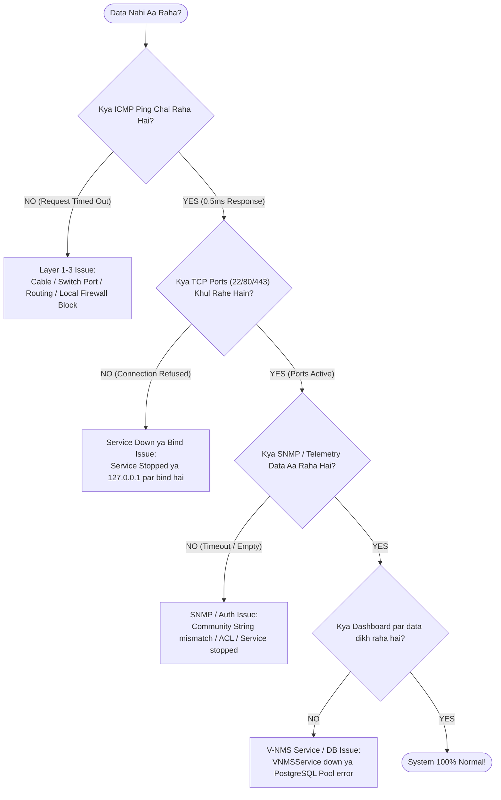

# V-NMS Enterprise Network Data Troubleshooting Guide: Errors & Solutions
*(Agar Network Data Na Aaye — Conditions, Errors, Root Causes aur Step-by-Step Solutions)*

---

## 📌 Executive Overview

Jab V-NMS Dashboard par kisi device ka status **Offline**, **Missing Ports**, **Blank Storage/Disks**, ya **Zero Telemetry** dikhta hai, to problem 6 alag-alag layers par ho sakti hai. 

Neeche diye gaye flowchart se aap **30 seconds me identify** kar sakte hain ki issue kahan hai:



---

## 🚨 Category 1: Physical & Link Layer Failures (Device Completely Unreachable)

### Condition 1.1: Device Powered Off, Cable Disconnected, ya Switch Port Down
* **Error Symptom:** Ping shows `Destination Host Unreachable` ya `Request timed out` (100% Packet Loss).
* **Root Cause:** Device ka power cut ho gaya hai, LAN cable disconnected hai, ya switch port `err-disabled` / `shutdown` state me chala gaya hai.
* **Diagnosis Step:**
  ```powershell
  # Check if MAC appears in ARP cache
  arp -a | findstr "TARGET_IP"
  ```
  Agar output blank hai, to device local link par present hi nahi hai.
* **Solution:**
  1. Server ya switch ka physical link light (Green/Amber LED) check karein.
  2. Switch CLI me jakar port status check karein:
     ```cisco
     show interface status | include <port_number>
     ```
  3. Agar port down hai to `no shutdown` command execute karein.

---

### Condition 1.2: VLAN Mismatch (Wrong Segment Assignment)
* **Error Symptom:** Device ka link LED green hai, lekin subnet se koi communication nahi ho raha.
* **Root Cause:** Device ko Switch ke galat VLAN port me daal diya gaya hai (e.g. Target device ko VLAN 20 me hona tha lekin port VLAN 1 me configured hai).
* **Solution:**
  * Switch port ka VLAN verify karke theek karein:
    ```cisco
    switchport mode access
    switchport access vlan <correct_vlan_id>
    ```

---

## 🛡️ Category 2: Routing & Firewall Drops (Ping / Packet Drop)

### Condition 2.1: Missing Route ya No Inter-VLAN Routing
* **Error Symptom:** V-NMS Server apne subnet (`172.168.1.0/24`) me sab scan karta hai, lekin doosre subnet (`192.168.10.0/24`) par data nahi aata.
* **Root Cause:** V-NMS host par default gateway configured nahi hai, ya Core Switch/Firewall par subnets ke beech inter-VLAN routing enable nahi hai.
* **Diagnosis Step:**
  ```powershell
  # Trace route from V-NMS Server
  tracert -d TARGET_IP
  ```
* **Solution:**
  1. V-NMS Server ka Default Gateway check karein (`172.168.1.1`).
  2. Router / Layer-3 Switch par IP Routing verify karein:
     ```cisco
     ip routing
     show ip route
     ```

---

### Condition 2.2: Host Firewall (Windows Defender / Linux iptables) Blocking ICMP
* **Error Symptom:** Device par Web / SSH chal raha hai, lekin Ping fail ho raha hai aur NMS use "DOWN" dikhata hai.
* **Root Cause:** Windows Firewall ya Linux `nftables` by default incoming ICMP Echo Requests (Ping) ko drop karta hai.
* **Solution:**
  * **Windows Server par Ping enable karne ka command (Run as Admin):**
    ```powershell
    netsh advfirewall firewall add rule name="Allow ICMPv4-In" protocol=icmpv4:8,any dir=in action=allow
    ```
  * **Linux (RHEL / Ubuntu) par Ping enable karne ka command:**
    ```bash
    sudo iptables -A INPUT -p icmp --icmp-type echo-request -j ACCEPT
    # Red Hat Firewall daemon:
    sudo firewall-cmd --add-icmp-block-inversion
    sudo firewall-cmd --reload
    ```

---

## 📡 Category 3: SNMP Telemetry Failures (Traffic, CPU, Memory Missing)

> [!IMPORTANT]
> Agar ping ho raha hai lekin Interface Bandwidth, Traffic Graph, ya CPU/RAM 0% dikha raha hai, to 95% cases me issue niche diye gaye 4 points me se ek hota hai.

### Condition 3.1: SNMP Agent Service Stopped ya Not Installed
* **Error Symptom:** `SNMP Query Timeout (Port 161)`
* **Root Cause:** Target Windows/Linux server par SNMP feature installed nahi hai ya service `Stopped` state me hai.
* **Solution:**
  * **Windows Server par fix:**
    ```powershell
    # Install SNMP if missing
    Add-WindowsCapability -Online -Name "SNMP.Client~~~~0.0.1.0"
    # Start and set Automatic
    Start-Service -Name SNMP
    Set-Service -Name SNMP -StartupType Automatic
    ```
  * **Linux (RHEL / Rocky / Ubuntu) par fix:**
    ```bash
    # RHEL / CentOS
    sudo dnf install -y net-snmp
    sudo systemctl enable --now snmpd
    
    # Ubuntu / Debian
    sudo apt install -y snmpd
    sudo systemctl enable --now snmpd
    ```

---

### Condition 3.2: SNMP Community String Mismatch
* **Error Symptom:** V-NMS poll karta hai lekin koi response nahi aata (Silent Drop).
* **Root Cause:** V-NMS default community string `public` use kar raha hai, jabki switch ya server par custom string (e.g. `corp_nms_2026`) set hai.
* **Solution:**
  * Target switch ya device par community string check karein:
    ```cisco
    show run | include snmp-server
    ```
  * Agar `public` allow karna hai:
    ```cisco
    snmp-server community public RO
    ```

---

### Condition 3.3: SNMP "Allowed Management Hosts" ACL Restriction
* **Error Symptom:** Same network par hone ke bawajood target device SNMP packet reject kar deta hai.
* **Root Cause:** Security policy ke mutabiq server sirf specific IP (jaise purana monitoring server) se SNMP query allow kar raha hai, aur naye V-NMS IP (`172.168.1.14` / `172.168.1.11`) ko allow nahi kiya gaya hai.
* **Solution:**
  * **Windows Service Config:**
    `services.msc` -> **SNMP Service** -> Properties -> **Security Tab** -> *"Accept SNMP packets from these hosts"* me V-NMS Server ka IP add karein (`172.168.1.14` aur `172.168.1.11`).
  * **Linux `/etc/snmp/snmpd.conf`:**
    ```text
    rocommunity public 172.168.1.14
    rocommunity public 172.168.1.11
    ```
    Save karke `sudo systemctl restart snmpd` karein.

---

## 💻 Category 4: Deep Server Telemetry (WMI / SSH / Database Listening Issues)

### Condition 4.1: Database / Application Service Bound to Localhost Only (`127.0.0.1`)
* **Error Symptom:** Server ke andar app chal rahi hai, lekin V-NMS scan me Port 5432 (Postgres), 27017 (Mongo), ya 9090 (Cockpit) open nahi dikhta.
* **Root Cause:** Service configuration me `bind_ip` sirf `127.0.0.1` par set hai, isliye network interface par bahar se traffic accept nahi ho raha.
* **Solution:**
  * **PostgreSQL (`postgresql.conf`):**
    ```text
    listen_addresses = '*'
    ```
    Aur `pg_hba.conf` me V-NMS subnet allow karein:
    ```text
    host all all 172.168.1.0/24 scram-sha-256
    ```
  * **MongoDB (`/etc/mongod.conf`):**
    ```yaml
    net:
      port: 27017
      bindIp: 0.0.0.0
    ```
  * Save karke respective service restart karein (`systemctl restart mongod / postgresql`).

---

### Condition 4.2: Windows WMI / RPC Error (0x800706BA "RPC Server Unavailable")
* **Error Symptom:** Disk Storage ya Physical Drives scan karte waqt `Get-CimInstance : The WinRM client cannot process the request` ya RPC timeout aata hai.
* **Root Cause:** Remote Windows host par Remote Registry, DCOM ya Windows Management Instrumentation traffic firewall dwara blocked hai.
* **Solution (Target Windows Machine par chalaein):**
  ```powershell
  # Enable Windows Remote Management
  winrm quickconfig -q
  # Open Firewall ports for WMI & DCOM
  netsh advfirewall firewall set rule group="Windows Management Instrumentation (WMI)" new enable=yes
  netsh advfirewall firewall set rule group="Remote Administration" new enable=yes
  ```

---

## ⚙️ Category 5: V-NMS Engine & Database Health

### Condition 5.1: `VNMSService` Crash ya Stopped
* **Error Symptom:** Browser me `http://172.168.1.14:8081` par `ERR_CONNECTION_REFUSED` aata hai.
* **Root Cause:** Server 14 ya Local host par background Go binary terminate ho gaya hai.
* **Diagnosis & Solution:**
  ```powershell
  # Check service
  Get-Service -Name VNMSService
  # If stopped, restart
  Start-Service -Name VNMSService
  ```

---

### Condition 5.2: PostgreSQL Database Connection Maxed Out
* **Error Symptom:** Backend log me `connection pool exhausted` ya `too many connections` error aata hai.
* **Root Cause:** PostgreSQL me `max_connections` limit exceed ho gayi hai.
* **Solution:**
  `C:\Program Files\PostgreSQL\18\data\postgresql.conf` me:
  ```text
  max_connections = 200
  ```
  Aur service restart karein: `Restart-Service -Name postgresql*`

---

## 📋 Quick Diagnostic Cheatsheet (60-Second Fix Table)

| Agar Ye Dikhe (Symptom) | Asli Wajah (Root Cause) | Immediate Fix Command |
| :--- | :--- | :--- |
| **Ping 100% Loss** | Cable unhooked / Port down / IP wrong | `arp -a \| findstr <IP>` |
| **Ping OK, lekin HTTP/SSH band** | Host service stopped ya firewall port closed | `Test-NetConnection -ComputerName <IP> -Port 22` |
| **Storage / Disk Data Missing** | Linux mount points unmapped / WMI blocked | WinRM / SSH service check karein |
| **Device Unknown Switch ban gaya** | Fallback port misdetection | `scanner.go` me MAC vendor verification run karein |
| **Doosre Subnet ka koi device na dikhe** | Inter-VLAN routing / Gateway missing | Router par `ip routing` verify karein |
| **SNMP Graphs Blank (0 Mbps)** | Community string mismatch / UDP 161 blocked | Target par `snmp-server community public RO` daalein |
| **UI Old Data Dikhaye** | Browser cache ya local outdated service | Hard Refresh (`Ctrl + Shift + R`) karein |

---

> [!TIP]
> **V-NMS Pro Tip:** Kisi bhi device ki live connectivity turant test karne ke liye PowerShell me ye 1-liner use karein:
> ```powershell
> Test-NetConnection -ComputerName <TARGET_IP> -Port <PORT>
> ```
> Agar `TcpTestSucceeded : True` aaye, to network level par sab kuch theek hai aur issue sirf application/credentials ka hai!
