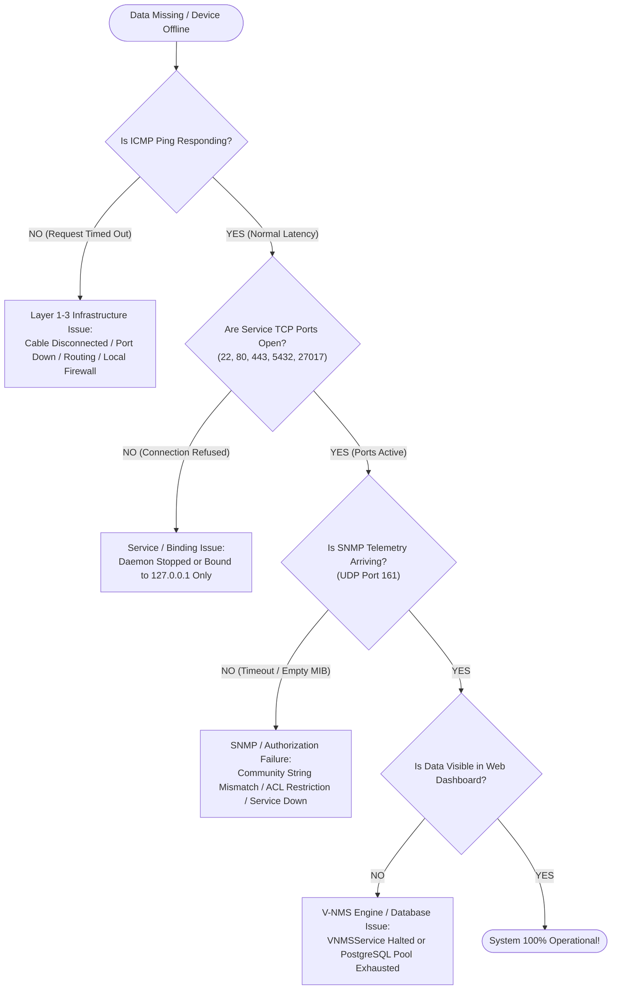

# V-NMS Enterprise Network Data & Polling Troubleshooting Guide
**Standard Operating Procedure (SOP): Diagnosing Missing Telemetry, Discovery Failures, and Offline Devices**

---

## 1. Executive Summary & Diagnostic Flowchart

When the V-NMS dashboard displays a device as **Offline**, **Missing Ports**, **Blank Storage/Disk IO**, or **Zero Traffic**, the underlying root cause can exist across six distinct infrastructure layers. 

Follow this 30-second diagnostic decision workflow to isolate the failing component:



---

## 2. Category 1: Physical & Data Link Layer Failures (Layer 1 & Layer 2)

### Condition 1.1: Physical Cable Disconnection, Power Loss, or Switch Port Err-Disabled
* **Symptom:** Target host shows 100% packet loss (`Destination Host Unreachable` or `Request timed out`).
* **Root Cause:** 
  1. The target device is powered down.
  2. Ethernet patch cord is unplugged or damaged.
  3. The switch port entered an `err-disabled` state due to BPDU Guard, Port Security, or duplex mismatch flapping.
* **Diagnostic Verification:**
  ```powershell
  # Check if the hardware MAC address exists in the local ARP cache
  arp -a | findstr "<TARGET_IP>"
  ```
  If the output is empty, the target is completely absent from the local physical broadcast domain.
* **Resolution Steps:**
  1. Inspect the physical Network Interface Card (NIC) link indicator LED (ensure solid amber/green link).
  2. On the upstream managed switch (e.g., Cisco Catalyst 9300), verify the interface state:
     ```cisco
     show interface status | include <PORT_ID>
     show interface <PORT_ID> err-disabled
     ```
  3. Reset the disabled port:
     ```cisco
     configure terminal
     interface <PORT_ID>
      shutdown
      no shutdown
     exit
     ```

---

### Condition 1.2: VLAN Assignment Mismatch
* **Symptom:** Link LED is active, but the device cannot reach or be reached by any other machine in the subnet.
* **Root Cause:** The switch port is assigned to an incorrect Access VLAN (e.g., Target is statically configured for `172.168.1.0/24` on VLAN 10, but the switch port is assigned to default VLAN 1).
* **Resolution Steps:**
  ```cisco
  configure terminal
  interface <PORT_ID>
   switchport mode access
   switchport access vlan 10
   spanning-tree portfast
  exit
  ```

---

## 3. Category 2: Routing & Firewall Filtering Failures (Layer 3 & Layer 4)

### Condition 2.1: Missing Default Gateway or Inactive Inter-VLAN Routing
* **Symptom:** V-NMS successfully discovers and monitors local subnet devices (`172.168.1.0/24`), but all targets on neighboring subnets (`192.168.10.0/24`, `10.0.0.0/24`) report 100% packet loss.
* **Root Cause:**
  1. The V-NMS host lacks a valid default gateway route (`172.168.1.1`).
  2. The upstream Layer-3 Core Switch or Firewall is not routing traffic between VLANs.
* **Diagnostic Verification:**
  ```powershell
  # Perform a non-resolving trace route to detect the exact hop where packets drop
  tracert -d <TARGET_IP>
  ```
* **Resolution Steps:**
  1. Confirm IP configuration and default route on the V-NMS server:
     ```powershell
     Get-NetRoute -DestinationPrefix "0.0.0.0/0"
     ```
  2. Verify that IP routing is globally enabled on the Core Switch:
     ```cisco
     show ip route
     configure terminal
     ip routing
     ```

---

### Condition 2.2: Host Operating System Firewall Dropping ICMP Echo Requests
* **Symptom:** Web and SSH services are accessible on the target, but ICMP Ping times out, causing V-NMS to mark the host as "DOWN".
* **Root Cause:** Windows Defender Firewall or Linux Netfilter (`nftables` / `iptables`) drops inbound ICMPv4 Type 8 Echo Requests by default.
* **Resolution Steps:**
  * **For Windows Server / Windows 11 (Run PowerShell as Administrator):**
    ```powershell
    netsh advfirewall firewall add rule name="Allow ICMPv4-Inbound" protocol=icmpv4:8,any dir=in action=allow
    ```
  * **For Red Hat Enterprise Linux 9 / Rocky Linux / CentOS:**
    ```bash
    sudo firewall-cmd --permanent --add-icmp-block-inversion
    sudo firewall-cmd --reload
    ```
  * **For Ubuntu Server / Debian:**
    ```bash
    sudo iptables -A INPUT -p icmp --icmp-type echo-request -j ACCEPT
    sudo netfilter-persistent save
    ```

---

## 4. Category 3: SNMP Telemetry & Polling Failures (Layer 7 Application)

> [!IMPORTANT]
> When ICMP Ping is alive and responsive, but Interface Bandwidth, Traffic Throughput, Memory, or CPU utilization graphs remain at 0% or empty, the issue resides in the SNMP agent configuration in 95% of cases.

### Condition 3.1: SNMP Daemon Service Stopped or Uninstalled
* **Symptom:** V-NMS log records `SNMP Query Timeout (UDP Port 161)`.
* **Root Cause:** The SNMP agent service is not running or not installed on the target machine.
* **Resolution Steps:**
  * **For Windows Server (PowerShell as Administrator):**
    ```powershell
    # Install Windows SNMP service if absent
    Add-WindowsCapability -Online -Name "SNMP.Client~~~~0.0.1.0"
    # Configure and start service
    Set-Service -Name SNMP -StartupType Automatic
    Start-Service -Name SNMP
    ```
  * **For Red Hat Enterprise Linux 9 / Rocky Linux 9:**
    ```bash
    sudo dnf install -y net-snmp net-snmp-utils
    sudo systemctl enable --now snmpd
    ```
  * **For Ubuntu Server 22.04 / 24.04 LTS:**
    ```bash
    sudo apt update && sudo apt install -y snmpd
    sudo systemctl enable --now snmpd
    ```

---

### Condition 3.2: SNMP Community String Mismatch
* **Symptom:** V-NMS sends SNMP GET requests, but the target silently drops all UDP packets without replying.
* **Root Cause:** V-NMS queries with default community string `public`, whereas the target device requires a specific custom string (e.g., `corp_nms_ro`).
* **Resolution Steps:**
  * **On Cisco Switch / Router:**
    ```cisco
    configure terminal
    snmp-server community public RO
    exit
    ```
  * **In V-NMS Settings:**
    Navigate to **Inventory &rarr; Edit Device &rarr; SNMP Configuration** and update the community string to match the device credentials.

---

### Condition 3.3: SNMP "Allowed Management Hosts" ACL Restriction
* **Symptom:** Target rejects SNMP queries despite having matching community strings and identical subnet connectivity.
* **Root Cause:** The host security policy restricts SNMP access strictly to an old monitoring IP address, excluding the active V-NMS engine (`172.168.1.14` and `172.168.1.11`).
* **Resolution Steps:**
  * **On Windows Server:**
    Open `services.msc` &rarr; Double-click **SNMP Service** &rarr; Select the **Security** tab &rarr; Under *"Accept SNMP packets from these hosts"*, add:
    * `172.168.1.14` (Central Production NOC)
    * `172.168.1.11` (Local NOC Host)
  * **On Linux (`/etc/snmp/snmpd.conf`):**
    ```text
    rocommunity public 172.168.1.14
    rocommunity public 172.168.1.11
    ```
    Apply changes: `sudo systemctl restart snmpd`.

---

## 5. Category 4: Deep Server Telemetry & Database Socket Issues

### Condition 4.1: Database / Microservice Bound Strictly to Localhost (`127.0.0.1`)
* **Symptom:** Services run normally inside the server, but V-NMS network discovery scans cannot detect PostgreSQL (`5432`), MongoDB (`27017`), Cockpit (`9090`), or Redis (`6379`).
* **Root Cause:** Configuration parameters bind the service listener strictly to loopback `127.0.0.1`, ignoring external network interfaces.
* **Resolution Steps:**
  * **PostgreSQL (`/var/lib/pgsql/data/postgresql.conf`):**
    ```text
    listen_addresses = '*'
    ```
    In `pg_hba.conf`, authorize subnet connections:
    ```text
    host all all 172.168.1.0/24 scram-sha-256
    ```
  * **MongoDB (`/etc/mongod.conf`):**
    ```yaml
    net:
      port: 27017
      bindIp: 0.0.0.0
    ```
  * **Redis (`/etc/redis/redis.conf`):**
    ```text
    bind 0.0.0.0
    protected-mode no
    ```
    Restart respective daemons: `sudo systemctl restart postgresql / mongod / redis`.

---

### Condition 4.2: Windows WMI / RPC Remote Error (0x800706BA "The RPC Server is Unavailable")
* **Symptom:** Physical disk hardware or storage volume queries fail with RPC or WinRM client errors.
* **Root Cause:** Windows DCOM / WMI remote administration endpoints are blocked by the target host firewall.
* **Resolution Steps (Execute on target Windows machine in Administrator PowerShell):**
  ```powershell
  # Configure Windows Remote Management
  winrm quickconfig -q
  
  # Enable required WMI and Remote Administration firewall rule groups
  netsh advfirewall firewall set rule group="Windows Management Instrumentation (WMI)" new enable=yes
  netsh advfirewall firewall set rule group="Remote Administration" new enable=yes
  ```

---

## 6. Category 5: V-NMS Engine & Pipeline Infrastructure Health

### Condition 5.1: `VNMSService` Process Inactive or Terminated
* **Symptom:** The web browser displays `ERR_CONNECTION_REFUSED` when accessing `http://172.168.1.14:8081`.
* **Root Cause:** The underlying background Windows Service (`vnms-server.exe`) was halted or crashed due to host restart.
* **Resolution Steps:**
  ```powershell
  # Check service state
  Get-Service -Name VNMSService
  
  # Restart service
  Restart-Service -Name VNMSService
  ```

---

### Condition 5.2: PostgreSQL Database Connection Pool Exhaustion
* **Symptom:** Backend engine logs record `pq: sorry, too many clients already` or `connection pool exhausted`.
* **Root Cause:** Active concurrent scanner threads and metric ingestion routines exceeded PostgreSQL default `max_connections` (100).
* **Resolution Steps:**
  In `C:\Program Files\PostgreSQL\18\data\postgresql.conf`:
  ```text
  max_connections = 250
  ```
  Restart the database service:
  ```powershell
  Restart-Service -Name postgresql*
  ```

---

## 7. Category 6: Comprehensive 60-Second Troubleshooting Cheatsheet

| Observed Symptom | Primary Root Cause | Immediate Diagnostic & Fix Command |
| :--- | :--- | :--- |
| **Ping 100% Loss** | Cable unhooked, port shutdown, wrong IP | `arp -a \| findstr <IP>` |
| **Ping Alive, Ports Closed** | Daemon stopped or bound to `127.0.0.1` | `Test-NetConnection -ComputerName <IP> -Port <PORT>` |
| **Storage / Disk Data Missing** | Linux mount unmapped / Windows RPC blocked | Run `winrm quickconfig -q` on target |
| **Linux Node Misclassified as Switch** | Port 80/443 fallback misdetection | Update to V-NMS v2.4 (OUI-based classification) |
| **Foreign Subnet Targets Inactive** | Missing Core Switch Inter-VLAN routing | Verify `ip routing` on Cisco Core Switch |
| **SNMP Graphs Flat (0 Mbps)** | Community string mismatch or UDP 161 blocked | Execute `snmp-server community public RO` on switch |
| **Browser Shows Stale / Cached UI** | Outdated local service binary or browser cache | Restart local `VNMSService` and press `Ctrl + Shift + R` |

---

> [!TIP]
> **Network Engineering Pro-Tip:**
> To verify complete Layer-3 and Layer-4 end-to-end reachability to any network node in under 3 seconds, execute:
> ```powershell
> Test-NetConnection -ComputerName <TARGET_IP> -Port <PORT_NUMBER>
> ```
> If `TcpTestSucceeded : True` is returned, physical cabling, inter-VLAN routing, and firewall policies are 100% verified, isolating the issue purely to host authentication or service configuration.
